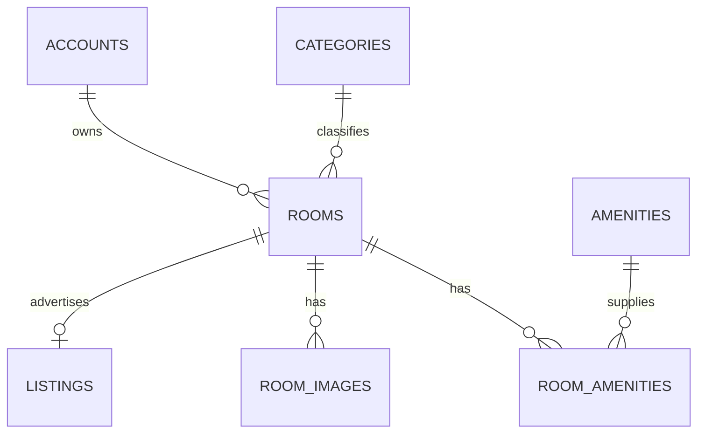
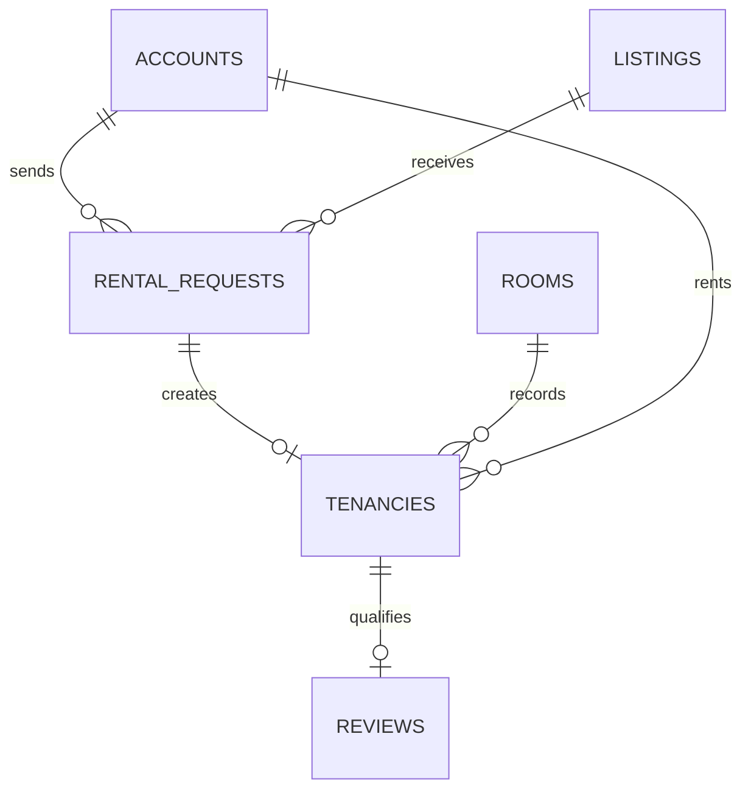
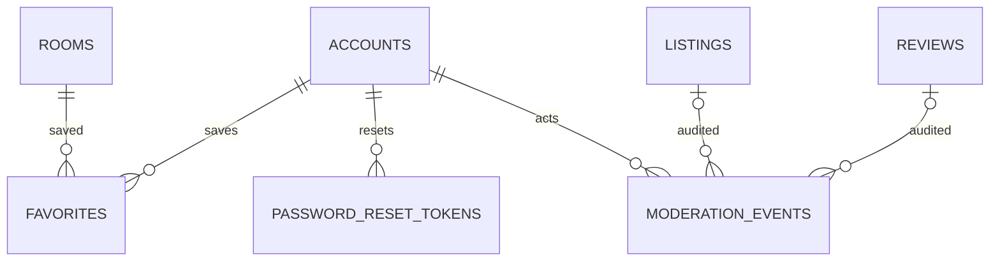
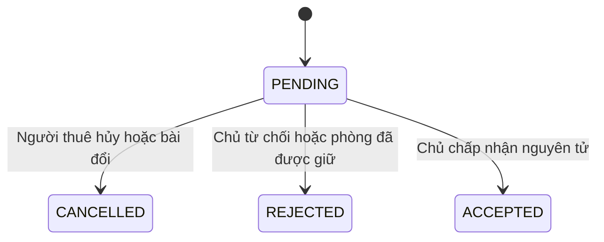
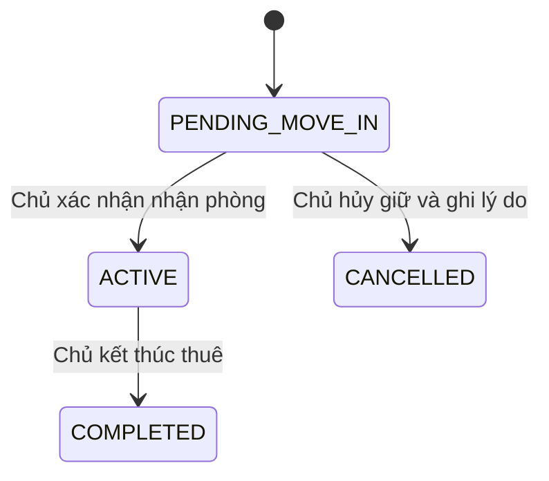

# QUẢN LÝ VÀ CHO THUÊ PHÒNG TRỌ TRỰC TUYẾN

## Hồ sơ phân tích và thiết kế — Giai đoạn 1

Ngày: 09/10/2026. Phiên bản đề xuất: 1.0, chờ chủ dự án duyệt.

Nguồn kiểm tra: bản `QuanLyPhongTro.zip` và ảnh biểu đồ lớp do người dùng cung cấp. Đây là thiết kế để duyệt, chưa phải hệ thống đã triển khai. Bản ZIP gốc và mã nguồn gốc không bị sửa. Không kết nối PostgreSQL trên MacBook, không thực thi DDL hay thay đổi dữ liệu.

## 1. Kết quả kiểm tra dự án hiện có

| Hạng mục | Bằng chứng trong bản ZIP | Kết luận |
|---|---|---|
| Maven | `pom.xml`, `mvnw`, `mvnw.cmd`, `.mvn/wrapper/maven-wrapper.properties` | Tiếp tục dự án hiện có; không cần tạo lại |
| Định danh | `com.quanlyphongtro:quanlyphongtro:0.0.1-SNAPSHOT` | Đúng package và tên dự án |
| Phiên bản | Parent Spring Boot `4.1.1`, `java.version=21`; wrapper trỏ Maven `3.9.16` | Giữ nguyên; kiểm tra dependency thực tế khi build |
| Điểm khởi chạy | `QuanLyPhongTroApplication.java` | Có `@SpringBootApplication` |
| MVC | `HomeController.java`: GET `/` trả về `index` | Đã có controller và view cơ bản |
| Giao diện | `templates/index.html` | Chỉ có tiêu đề và lời chào; chưa có luồng nghiệp vụ |
| Dependencies | JPA, Security, Thymeleaf, Validation, WebMVC, PostgreSQL, Lombok, DevTools và các starter test | Đủ nền tảng chính |
| Bảo mật | Có starter Security, chưa có `SecurityFilterChain` hoặc `UserDetailsService` tùy chỉnh trong source | Chưa có phân quyền nghiệp vụ; việc trang chủ từng hiển thị chưa chứng minh quyền truy cập công khai đúng |
| CSDL | URL `jdbc:postgresql://localhost:5432/quanlyphongtro`; username `postgres`; password `${DB_PASSWORD}` | Mật khẩu đã tách khỏi source; giữ nguyên biến môi trường |
| Hibernate | `ddl-auto=update`, `show-sql=true` | Đề xuất chuyển sang migration có phiên bản sau khi kiểm tra schema và sao lưu |
| Kiểm thử | Một `@SpringBootTest` với `contextLoads()` | Chưa kiểm thử nghiệp vụ; test hiện tại có thể phụ thuộc DB cấu hình mặc định |
| Dữ liệu/domain | Chưa có Entity, Service, Repository, migration hay seed trong source | Mới là ứng dụng khởi tạo |
| Tệp build | ZIP có `target/classes` chứa class và tài nguyên đã biên dịch | Chứng cứ từng biên dịch; không thay thế build/test hiện tại |

Đã kiểm tra: ZIP không lỗi CRC; XML của POM hợp lệ; đọc toàn bộ source Java, template, cấu hình ứng dụng, test và wrapper. Không in giá trị bí mật.

Giới hạn kiểm chứng: môi trường kiểm tra này có Java 17 và không có lệnh `mvn`; chưa chạy Maven wrapper hay build/test JDK 21. Không xác nhận lại kết nối HikariCP, phiên bản PostgreSQL 18.6, schema hiện tại hay trạng thái localhost:8080 trên MacBook. Các thông tin chạy thành công trên máy người dùng được ghi nhận theo mô tả, không phải kết quả thực thi ở đây.

Đối chiếu tài liệu chính thức: Spring Boot 4.1.1 hỗ trợ Java 21 và Maven từ 3.6.3. Bảng dependencies của Boot hiện vẫn quản lý `thymeleaf-extras-springsecurity6`; vì vậy tên dependency này trong POM không tự nó là lỗi. Giữ quản lý phiên bản bằng Boot; sau này kiểm tra cây dependency và render `sec:authorize` thực tế, không tự thay bằng artifact `springsecurity7` chưa xác minh.

Nguồn kỹ thuật đã đối chiếu ngày 09/10/2026:

- https://docs.spring.io/spring-boot/system-requirements.html
- https://docs.spring.io/spring-boot/appendix/dependency-versions/coordinates.html

## 2. Phạm vi và các quyết định cần duyệt

Đề xuất một ứng dụng Spring MVC + Thymeleaf, triển khai một khối, phục vụ ba vai trò. Các trang quản trị, chủ trọ và người thuê dùng chung backend, giao diện theo từng vai trò.

| Vấn đề cần chốt | Đề xuất cho bản đồ án |
|---|---|
| Một bản ghi phòng đại diện điều gì? | Một phòng vật lý cho một nhóm thuê, do một người đại diện đứng tên. Có thể có nhiều người ở theo `max_occupants`, nhưng chỉ một hồ sơ thuê đang giữ phòng |
| Phòng và bài đăng | Tách `rooms` và `listings`; mỗi phòng có tối đa một bài đăng, sửa và tái sử dụng qua các đợt cho thuê |
| Một người có nhiều vai trò? | Một tài khoản có một vai trò: TENANT, LANDLORD hoặc ADMIN. Chủ trọ muốn thử luồng thuê dùng tài khoản TENANT riêng |
| Đăng ký | Người dùng chọn TENANT hoặc LANDLORD. ADMIN chỉ được khởi tạo bằng quy trình quản trị, không qua form công khai |
| Hợp đồng/hóa đơn trong ảnh | Chưa triển khai ký hợp đồng, tiền điện nước, hóa đơn, thanh toán trực tuyến. UC11 dùng hồ sơ thuê và lịch sử thuê đơn giản |
| Ý nghĩa chấp nhận yêu cầu | Giữ phòng và tạo hồ sơ thuê PENDING_MOVE_IN; chưa đồng nghĩa người thuê đã nhận phòng |
| Đánh giá | Chỉ người có hồ sơ thuê ACTIVE hoặc COMPLETED mới đánh giá được; một đánh giá cho mỗi hồ sơ thuê |
| Quên mật khẩu | Link token một lần qua email SMTP; demo không có SMTP dùng hộp thư giả lập cục bộ, không cung cấp token cho khách qua trang web |
| Địa điểm và bản đồ | Tỉnh/thành, xã/phường, địa chỉ cụ thể; tọa độ tùy chọn. Mở bản đồ bằng tọa độ, không tích hợp tìm địa chỉ tự động trả phí |
| Thống kê | Tài khoản, bài đăng, phòng, yêu cầu, hồ sơ thuê theo thời gian; không gọi giá niêm yết là doanh thu thực thu |

Chưa bổ sung chat, đặt lịch xem phòng, ví điện tử, AI gợi ý, thanh toán hoặc xác minh CCCD. Đây là phần mở rộng chỉ làm sau khi thống nhất riêng.

## 3. Rà soát và điều chỉnh Use Case

Danh sách ban đầu hợp lý về nhóm tác nhân nhưng một số UC gộp nhiều mục tiêu. Giữ mã UC01–UC14 để thuận tiện báo cáo; dùng hậu tố cho luồng con.

| Mã | Chức năng sau điều chỉnh | Tác nhân | Quy tắc và kết quả chính |
|---|---|---|---|
| UC01 | Đăng ký tài khoản | Khách | Email không trùng; TENANT/LANDLORD; băm mật khẩu; không tự chọn ADMIN |
| UC02a | Đăng nhập | Khách | Tài khoản ACTIVE; thông báo lỗi không tiết lộ email có tồn tại |
| UC02b | Đăng xuất | Người đã đăng nhập | POST có CSRF; hủy session |
| UC02c | Yêu cầu và đặt lại mật khẩu | Khách | Token băm, hạn 15 phút, một lần; phản hồi yêu cầu giống nhau cho email tồn tại/không tồn tại |
| UC03a | Xem/cập nhật hồ sơ | Ba vai trò | Chỉ hồ sơ chính mình; tên, điện thoại, avatar tùy chọn. Email đăng nhập chưa cho tự đổi trong bản đầu |
| UC03b | Đổi mật khẩu | Ba vai trò | Xác nhận mật khẩu cũ; vô hiệu token reset và session khác |
| UC04 | Tìm kiếm/lọc/sắp xếp/phân trang | Khách, TENANT | Chỉ bài được duyệt, hiện, phòng AVAILABLE, chủ ACTIVE; lọc giá, diện tích, địa điểm, loại phòng, tiện ích |
| UC05 | Xem chi tiết phòng | Khách, TENANT | Hình, chi phí, tiện ích, địa chỉ/bản đồ, đánh giá còn hiển thị; bài không công khai không được lộ qua URL trực tiếp |
| UC06 | Thêm/bỏ/xem yêu thích | TENANT | Không trùng cặp người–phòng; bài hết khả dụng hiện nhãn hoặc placeholder, không lộ nội dung đã bị chặn |
| UC07 | Gửi/hủy/theo dõi yêu cầu thuê | TENANT | Một yêu cầu PENDING/người/phòng; gửi chỉ khi phòng đang công khai và trống; hủy trước khi chủ chấp nhận |
| UC08 | Viết/sửa/xóa nhận xét | TENANT | Có hồ sơ thuê đủ điều kiện, 1–5 sao; không đánh giá chỉ vì đã gửi yêu cầu |
| UC09a | Quản lý phòng vật lý | LANDLORD | Thêm/sửa thông tin phòng của mình; trạng thái có người thuê không được đổi bằng form thường |
| UC09b | Quản lý bài đăng | LANDLORD | Soạn/lưu nháp/gửi duyệt/sửa/ẩn-hiện/lưu trữ; hiện chỉ sau duyệt. “Xóa” trên UI là lưu trữ, giữ lịch sử |
| UC10 | Xử lý yêu cầu thuê | LANDLORD | Chỉ phòng của mình; chấp nhận hoặc từ chối có lý do; chấp nhận nguyên tử tránh nhận hai người |
| UC11 | Quản lý hồ sơ thuê và lịch sử | LANDLORD | Xác nhận nhận phòng, hủy giữ phòng, kết thúc thuê; xem người đại diện, ngày, giá đã chốt |
| UC12 | Quản lý người dùng | ADMIN | Tìm/xem/khóa/mở khóa; không xem mật khẩu; không xóa lịch sử; không tự khóa tài khoản hoặc khóa ADMIN cuối cùng |
| UC13 | Kiểm duyệt/quản lý bài đăng | ADMIN | Duyệt/từ chối có lý do/chặn vi phạm/khôi phục; xem lịch sử quyết định |
| UC14 | Thống kê/báo cáo hoạt động | ADMIN | Bộ lọc khoảng thời gian, số lượng theo trạng thái; xuất CSV khi cần |
| UC15, đề xuất bổ sung | Quản lý loại phòng và tiện ích | ADMIN | Kích hoạt/ngừng dùng danh mục; không xóa mục đã có tham chiếu |
| UC16, đề xuất bổ sung | Kiểm duyệt đánh giá | ADMIN | Ẩn/khôi phục nhận xét vi phạm với lý do; tính lại điểm từ nhận xét VISIBLE |

UC09a và UC11 là phần làm rõ nghiệp vụ, không phải hệ thống quản lý hợp đồng. UC15 và UC16 cần duyệt như bổ sung nhỏ; nếu chưa duyệt UC15 có thể seed danh mục chỉ đọc, còn UC16 cần thống nhất cách xử lý nhận xét vi phạm trước khi cho dùng thực tế.

### Đặc tả các luồng quyết định

**Gửi yêu cầu thuê:** TENANT ACTIVE đăng nhập → mở phòng công khai → nhập ngày dự kiến và lời nhắn → server kiểm tra điều kiện hiện tại → tạo PENDING và snapshot giá/bài đăng. Nếu phòng vừa hết khả dụng hoặc có yêu cầu đang chờ, trả thông báo phù hợp, không tạo trùng.

**Chấp nhận yêu cầu:** chủ của phòng ACTIVE → chọn yêu cầu PENDING → kiểm tra phiên bản bài đăng và điều kiện công khai → transaction khóa bản ghi phòng → kiểm tra lại phòng AVAILABLE → tạo hồ sơ PENDING_MOVE_IN → phòng RESERVED → yêu cầu ACCEPTED → các yêu cầu PENDING còn lại cho phòng thành REJECTED, lý do phòng đã được giữ → commit. Nếu tranh chấp đồng thời, chỉ một giao dịch thành công. Không gửi email bên trong transaction đang giữ khóa.

**Nhận phòng:** chủ xác nhận thực tế → hồ sơ PENDING_MOVE_IN thành ACTIVE → phòng OCCUPIED. Cập nhật cùng transaction. Không coi hành động này là hợp đồng có chữ ký điện tử.

**Kết thúc thuê:** chủ nhập ngày kết thúc và lý do → hồ sơ ACTIVE thành COMPLETED → phòng AVAILABLE hoặc MAINTENANCE theo lựa chọn → bài đăng được đặt ẩn để chủ cập nhật trước khi tái mở. Giá chốt và người thuê cũ giữ nguyên.

**Sửa bài đã duyệt:** kiểm tra chủ sở hữu và phiên bản → cập nhật nội dung → đưa về PENDING_REVIEW, tạm dừng công khai. Yêu cầu PENDING gắn nội dung cũ thành CANCELLED với lý do bài thay đổi; yêu cầu ACCEPTED và hồ sơ thuê giữ snapshot. Chủ không thể chấp nhận yêu cầu dựa vào giá cũ rồi áp giá mới.

## 4. Ma trận phân quyền

Các vai trò không kế thừa nhau. ADMIN không tự động có quyền sửa hồ sơ người thuê hoặc thao tác như chủ phòng. Mọi truy vấn chi tiết phải kiểm tra quyền trên từng đối tượng, không chỉ ẩn nút UI.

| Tài nguyên/hành động | Khách | TENANT | LANDLORD | ADMIN |
|---|---|---|---|---|
| Tìm và xem nội dung công khai | Có | Có | Có | Có |
| Hồ sơ, đổi mật khẩu | Không | Chính mình | Chính mình | Chính mình |
| Yêu thích/yêu cầu/nhận xét | Không | Chính mình, có điều kiện | Không | Chỉ kiểm duyệt nhận xét nếu UC16 được duyệt |
| Phòng/bài đăng chưa công khai | Không | Không | Phòng của mình | Để kiểm duyệt |
| Sửa phòng/bài đăng | Không | Không | Phòng của mình | Chặn/duyệt; không tự đổi giá/nội dung của chủ |
| Xem yêu cầu thuê | Không | Yêu cầu của mình | Yêu cầu của phòng mình | Số liệu tổng hợp, không đọc lời nhắn mặc định |
| Chấp nhận/từ chối yêu cầu | Không | Không | Phòng của mình | Không |
| Hồ sơ thuê, thông tin liên hệ | Không | Hồ sơ của mình, chỉ đọc | Hồ sơ của phòng mình | Chỉ số tổng hợp mặc định |
| Khóa tài khoản/danh mục | Không | Không | Không | Có, theo quy tắc |
| Dashboard hệ thống | Không | Không | Không | Có |

Điện thoại chủ trọ được hiển thị như thông tin liên hệ có chủ động cung cấp; email đăng nhập không công khai. Chủ chỉ xem liên hệ người gửi yêu cầu cho phòng mình; danh sách khách thuê không truy cập công khai.

## 5. Kiến trúc phần mềm

Giữ `com.quanlyphongtro` và điểm khởi chạy hiện có. Dùng mô hình MVC, server render HTML; JavaScript xử lý preview ảnh, tương tác bộ lọc và thông báo. Không cần SPA hoặc JWT cho website dùng session.

| Package/tài nguyên | Trách nhiệm đề xuất |
|---|---|
| `controller` | Auth, Profile, PublicRoom, Favorite, RentalRequest, LandlordRoom, LandlordListing, LandlordRental, AdminUser, AdminModeration, AdminReport |
| `service` | AuthService, ProfileService, RoomSearchService, ListingService, RentalRequestService, TenancyService, ReviewService, StorageService, ReportService |
| `repository` | JPA repositories, truy vấn ownership, phân trang và Specification tìm kiếm |
| `entity` | Account, Room, Listing, RentalRequest, Tenancy và các entity phụ |
| `dto` | Form đăng ký, hồ sơ, phòng, bài đăng; kết quả tìm kiếm và dashboard. Không bind Entity trực tiếp từ form |
| `enums` | Role và trạng thái nghiệp vụ |
| `config` | Security, cấu hình upload, đồng hồ/timezone và môi trường |
| `security` | UserDetailsService, kiểm tra principal/ownership, quản lý session và tài khoản bị khóa |
| `exception` | Lỗi nghiệp vụ, 403/404/409, `@ControllerAdvice` |
| `resources/templates` | layouts/fragments, public, auth, tenant, landlord, admin, error |
| `resources/static` | CSS, JS, icon và tài nguyên demo; không chứa ảnh upload thực tế |
| `resources/db/migration` | Migration Flyway sau khi duyệt |
| `src/test` | Unit, MVC/security, repository PostgreSQL, integration và dữ liệu fixture |

Luồng đọc: Controller nhận tham số → DTO/Validation → Service áp dụng quyền và nghiệp vụ → Repository đọc DB → DTO kết quả → Thymeleaf. Luồng ghi: tương tự, nhưng transaction đặt ở Service và redirect sau POST để giảm gửi lại form.

Không cần interface cho mọi Service chỉ có một implementation. Dùng constructor injection; quan hệ JPA tải LAZY, ánh xạ DTO trong transaction và đề xuất `open-in-view=false`. Tránh `@Data` trên entity có quan hệ hai chiều để không tạo vòng lặp `toString/equals`.

Các endpoint chính: `/`, `/rooms`, `/rooms/{id}`, `/auth/**`, `/profile/**`, `/tenant/**`, `/landlord/**`, `/admin/**`. Tất cả thay đổi trạng thái dùng POST có CSRF, không thay đổi dữ liệu bằng GET. ID tài khoản thao tác lấy từ principal, không tin `ownerId/tenantId/role/status` gửi từ trình duyệt.

## 6. Đánh giá biểu đồ lớp đính kèm

| Điểm trong ảnh | Điều chỉnh đề xuất |
|---|---|
| Có Room nhưng thiếu Listing | Tách tài sản vật lý khỏi trạng thái duyệt/hiển thị nội dung |
| Có Contract nhưng thiếu RentalRequest | Thêm yêu cầu thuê trước khi sinh hồ sơ thuê |
| Invoice và PaymentStatus | Đưa ra ngoài phạm vi bản đầu vì không có UC hóa đơn/thanh toán |
| Account + Admin/Landlord/Tenant chứa tên bị lặp | Dùng một Account có vai trò và hồ sơ cơ bản; không cần bảng profile theo vai trò khi chưa có trường riêng cần thiết |
| CCCD, ảnh hai mặt, thông tin ngân hàng | Bỏ khỏi bản đầu vì chưa có UC xác minh hoặc thanh toán |
| Đường quan hệ Review/Favorite đi từ Contract | Sửa: người dùng viết/lưu; phòng được đánh giá/lưu. Review liên kết Tenancy để chứng minh đã thuê; Favorite không phụ thuộc hồ sơ thuê |
| `area: Float` | Dùng `numeric(8,2)`/BigDecimal để quản lý dữ liệu ổn định |
| `city/district/ward` gộp một trường | Tách tỉnh/thành, xã/phường, địa chỉ. Không bắt buộc mô hình địa giới ba cấp trong thiết kế mới |
| Chưa thể hiện chống trùng và giữ lịch sử | Thêm unique, partial unique index, version và trạng thái lưu trữ |

## 7. Thiết kế cơ sở dữ liệu PostgreSQL

Thiết kế logic gồm **13 bảng** nếu duyệt cả UC15–UC16. Các bảng danh mục vẫn cần cho tìm kiếm dù chưa có màn quản trị. Đặt tên snake_case, PK `bigint generated by default as identity`; Java dùng Long. Tiền dùng `numeric(14,2)` và BigDecimal, đơn vị VND/tháng; diện tích m². Ngày dùng `date`; thời điểm dùng `timestamptz`/Instant, hiển thị Asia/Ho_Chi_Minh. Enum dùng varchar + CHECK và Java `EnumType.STRING`.

PK/FK bên dưới là thiết kế, chưa chạy tạo bảng. Trường ghi NN là NOT NULL. Trường không ghi tùy chọn được nêu theo từng bảng. Các bảng thay đổi đồng thời có `version bigint NN default 0` để ánh xạ `@Version`.

### 7.1 Từ điển dữ liệu

| Bảng | Cột và ràng buộc chính |
|---|---|
| `accounts` | `id` PK; `email varchar(254) NN`, unique theo `lower(email)`; `password_hash varchar(255) NN`; `full_name varchar(120) NN`; `phone varchar(20)` tùy chọn; `avatar_storage_key varchar(255)` tùy chọn; `role varchar(20) NN` = TENANT/LANDLORD/ADMIN; `status varchar(20) NN` = ACTIVE/BANNED; `created_at, updated_at timestamptz NN`; `version` |
| `categories` | `id` PK; `name varchar(80) NN`, unique chuẩn hóa; `active boolean NN default true` |
| `amenities` | `id` PK; `name varchar(80) NN`, unique chuẩn hóa; `active boolean NN default true` |
| `rooms` | `id` PK; `landlord_id` FK accounts NN; `category_id` FK categories NN; `code varchar(40) NN` unique theo chủ; `province varchar(100) NN`; `ward varchar(100) NN`; `address_line varchar(255) NN`; `latitude numeric(9,6), longitude numeric(9,6)` tùy chọn; `area numeric(8,2) NN > 0`; `max_occupants integer NN > 0`; `status varchar(20) NN`; `created_at, updated_at NN`; `version` |
| `listings` | `id` PK; `room_id` FK rooms NN UNIQUE; `title varchar(180) NN`; `description text NN`; `monthly_rent numeric(14,2) NN > 0`; `deposit numeric(14,2) NN >= 0`; `electricity_unit_price, water_unit_price, service_fee numeric(14,2) NN >= 0`; `water_billing_method varchar(20) NN` = PER_M3/PER_PERSON; `available_from date NN`; `moderation_status varchar(30) NN`; `visible boolean NN default false`; `submitted_at, reviewed_at timestamptz` tùy chọn; `reviewed_by` FK accounts tùy chọn; `moderation_reason varchar(1000)` tùy chọn; `created_at, updated_at NN`; `version` |
| `room_images` | `id` PK; `room_id` FK rooms NN; `storage_key varchar(255) NN UNIQUE`; `alt_text varchar(255)` tùy chọn; `sort_order integer NN >= 0`; `is_cover boolean NN default false`; `created_at NN` |
| `room_amenities` | `room_id` FK rooms + `amenity_id` FK amenities, PK kép; không cần id riêng |
| `favorites` | `account_id` FK accounts + `room_id` FK rooms, PK kép; `created_at NN` |
| `rental_requests` | `id` PK; `listing_id` FK listings NN; `tenant_id` FK accounts NN; `status varchar(20) NN`; `requested_move_in date NN`; `message varchar(1000)` tùy chọn; `listing_version_snapshot bigint NN`; `rent_snapshot, deposit_snapshot numeric(14,2) NN`; `title_snapshot varchar(180) NN`; `created_at NN`; `processed_at timestamptz, processed_by` FK accounts và `decision_reason varchar(1000)` tùy chọn; `version` |
| `tenancies` | `id` PK; `request_id` FK rental_requests NN UNIQUE; `room_id` FK rooms NN; `tenant_id` FK accounts NN; `status varchar(30) NN`; `planned_start_date date NN`; `actual_start_date, end_date date` tùy chọn; `monthly_rent_snapshot, deposit_snapshot numeric(14,2) NN`; `room_address_snapshot varchar(500) NN`; `closure_reason varchar(1000)` tùy chọn; `created_at, updated_at NN`; `version` |
| `reviews` | `id` PK; `tenancy_id` FK tenancies NN UNIQUE; `rating smallint NN` CHECK 1..5; `comment varchar(2000) NN`; `status varchar(20) NN` = VISIBLE/HIDDEN/DELETED; `created_at, updated_at NN`; `version`. Người viết và phòng suy ra từ tenancy, không lặp FK dễ mâu thuẫn |
| `password_reset_tokens` | `id` PK; `account_id` FK accounts NN; `token_hash varchar(64) NN UNIQUE`; `expires_at, created_at timestamptz NN`; `used_at timestamptz` tùy chọn; không lưu token gốc |
| `moderation_events` | `id` PK; `actor_id` FK accounts NN; `listing_id` FK listings tùy chọn; `review_id` FK reviews tùy chọn; CHECK đúng một target có giá trị; `action varchar(30) NN`; `from_status, to_status varchar(30) NN`; `reason varchar(1000)` tùy chọn, bắt buộc cho từ chối/chặn/ẩn; `created_at NN` |

`water_unit_price` có đơn vị theo `water_billing_method`, điện tính VND/kWh, phí dịch vụ VND/tháng. Đây chỉ là chi phí công bố, không tự tạo hóa đơn. Hiển thị đơn vị đầy đủ trên form và trang chi tiết.

`landlord_id` chỉ nhận tài khoản LANDLORD; `tenant_id` chỉ nhận TENANT; `reviewed_by` chỉ nhận ADMIN. FK thông thường không bảo đảm vai trò nên Service phải kiểm tra và test. Bản đầu không cho đổi role hoặc chuyển chủ phòng sau khi phát sinh lịch sử.

### 7.2 Quan hệ

Trong sơ đồ cuối mỗi sự kiện chỉ gắn một trong hai target nhờ CHECK, không đồng thời cả bài đăng và nhận xét.

### 7.3 Ràng buộc và chỉ mục cần triển khai

- UNIQUE `lower(email)`, chuẩn hóa trim/lower khi nhập; đăng nhập bằng email, không duy trì thêm username.
- UNIQUE `(landlord_id, code)`, `listings(room_id)`, `tenancies(request_id)`, `reviews(tenancy_id)`.
- Partial unique `rental_requests(tenant_id, listing_id) WHERE status='PENDING'`: cho phép gửi lại sau khi bị từ chối/hủy, không có hai yêu cầu chờ.
- Partial unique `tenancies(room_id) WHERE status IN ('PENDING_MOVE_IN','ACTIVE')`: chỉ một hồ sơ giữ phòng tại một thời điểm.
- Partial unique `room_images(room_id) WHERE is_cover=true`: tối đa một ảnh bìa. Service bảo đảm ít nhất một ảnh bìa trước khi gửi duyệt.
- CHECK latitude từ -90..90, longitude -180..180, hai tọa độ cùng có hoặc cùng null; giá/diện tích/số người hợp lệ; trạng thái thuộc tập định nghĩa.
- CHECK `actual_start_date` bắt buộc cho ACTIVE/COMPLETED, `end_date` bắt buộc cho COMPLETED và không trước ngày bắt đầu; PENDING_MOVE_IN không có ngày thực tế; CANCELLED chỉ xuất phát trước nhận phòng.
- Chỉ mục FK phục vụ truy vấn: rooms(landlord_id), rental_requests(listing_id,status,created_at), rental_requests(tenant_id,created_at), tenancies(tenant_id,status), favorites(room_id), room_images(room_id,sort_order), moderation_events(target,created_at), tokens(account_id,expires_at).
- Tìm kiếm bắt đầu với B-tree địa điểm/trạng thái, giá ở listings và phân trang; không thêm search engine. Chọn chỉ mục tổng hợp cụ thể sau khi có truy vấn và EXPLAIN, không hứa mọi ILIKE được B-tree tăng tốc.
- Không cascade remove từ accounts/rooms/listings sang yêu cầu, hồ sơ thuê, đánh giá. Dùng FK RESTRICT với lịch sử; bảng liên kết không lịch sử có thể cascade khi purge có kiểm soát sau này.
- Không hard delete account/phòng trong bản đầu. Tài khoản bị khóa, phòng/bài đăng lưu trữ. Thông tin thuê và audit vẫn còn.
- Ràng buộc nhất quán `request.listing.room_id = tenancy.room_id`, `request.tenant_id = tenancy.tenant_id`, request ACCEPTED và trạng thái phòng–hồ sơ được Service kiểm tra trong cùng transaction. Các partial unique là lớp bảo vệ bổ sung ở DB.

## 8. Trạng thái và quy tắc nghiệp vụ

### 8.1 Phòng vật lý

| Trạng thái | Ý nghĩa | Cách thay đổi |
|---|---|---|
| AVAILABLE | Có thể nhận yêu cầu nếu bài công khai | Tạo phòng hoặc sau kết thúc/hủy giữ |
| RESERVED | Có hồ sơ PENDING_MOVE_IN | Chỉ qua chấp nhận yêu cầu |
| OCCUPIED | Có hồ sơ ACTIVE | Chỉ qua xác nhận nhận phòng |
| MAINTENANCE | Tạm không cho thuê | Chủ đổi khi không có hồ sơ giữ phòng |
| ARCHIVED | Ngừng kinh doanh/lưu trữ | Chỉ khi không có hồ sơ giữ phòng |

AVAILABLE ↔ MAINTENANCE do chủ; AVAILABLE → RESERVED → OCCUPIED theo quy trình thuê. RESERVED → AVAILABLE khi hủy giữ; OCCUPIED → AVAILABLE/MAINTENANCE khi kết thúc thuê. AVAILABLE/MAINTENANCE → ARCHIVED khi lưu trữ; khôi phục ARCHIVED → MAINTENANCE để kiểm tra trước khi mở. Không trực tiếp đổi OCCUPIED về AVAILABLE bằng form sửa phòng.

### 8.2 Bài đăng

Trạng thái kiểm duyệt: DRAFT, PENDING_REVIEW, APPROVED, REJECTED, BLOCKED, ARCHIVED. `visible` là ý định hiện/ẩn của chủ, độc lập với phòng đang trống hay đã thuê.

| Chuyển trạng thái | Người thực hiện/điều kiện |
|---|---|
| DRAFT/REJECTED → PENDING_REVIEW | Chủ gửi; đủ thông tin và ảnh |
| PENDING_REVIEW → APPROVED/REJECTED | ADMIN quyết định, từ chối cần lý do |
| APPROVED → PENDING_REVIEW | Chủ sửa nội dung công khai hoặc thuộc tính phòng/ảnh/tiện ích ảnh hưởng bài đăng |
| PENDING_REVIEW → DRAFT | Chủ rút bài để sửa |
| APPROVED → BLOCKED | ADMIN chặn vi phạm, có lý do |
| BLOCKED → PENDING_REVIEW | ADMIN mở chặn cho phép chủ chỉnh và gửi lại; chủ không tự bỏ chặn |
| Trạng thái chưa lưu trữ → ARCHIVED | Chủ lưu trữ nếu không có hồ sơ giữ phòng; lưu lịch sử |
| ARCHIVED → DRAFT | Chủ khôi phục; phải gửi duyệt lại |

Chủ ẩn/hiện bài APPROVED bằng `visible`. Ẩn không xóa phê duyệt; BLOCKED không thể công khai dù visible=true. Lưu trữ phòng làm bài ARCHIVED; danh mục bị ngừng dùng không tự gỡ các bài cũ.

Điều kiện xuất hiện trên trang tìm kiếm và chi tiết công khai:

`account.status=ACTIVE AND room.status=AVAILABLE AND listing.moderation_status=APPROVED AND listing.visible=true`.

Ngày có thể nhận phòng được hiển thị; ngày gửi yêu cầu dự kiến phải từ hôm nay và không sớm hơn `available_from`. Phòng cho thuê trong tương lai vẫn có thể nhận yêu cầu cho ngày phù hợp.

### 8.3 Yêu cầu và hồ sơ thuê

Yêu cầu ACCEPTED giữ nguyên như lịch sử quyết định, kể cả khi hồ sơ thuê sau này CANCELLED. Người thuê không dùng “hủy yêu cầu” sau ACCEPTED; liên hệ chủ để hủy giữ phòng. Chưa thêm quy trình tranh chấp hoặc hoàn cọc. Không tự hết hạn giữ phòng: chủ hủy thủ công có lý do, tránh bổ sung scheduler/hoàn tiền ngoài phạm vi.

Các invariant bắt buộc:

1. Một room có tối đa một tenancy PENDING_MOVE_IN/ACTIVE.
2. RESERVED tương ứng PENDING_MOVE_IN; OCCUPIED tương ứng ACTIVE; trạng thái khác không có tenancy đang giữ phòng.
3. Chấp nhận request và tạo tenancy là một transaction, không để request ACCEPTED nhưng chưa có tenancy.
4. Giá trên tenancy lấy từ snapshot đã được người thuê xem và không sửa khi giá bài đăng thay đổi.
5. Chủ không sửa vị trí/loại/diện tích/chi phí và ảnh của phòng đang RESERVED/OCCUPIED trong bản đầu; có thể ẩn bài. Thay đổi thông tin sau khi kết thúc thuê.
6. Chủ khóa/ẩn/chặn/lưu trữ bài hoặc đưa phòng bảo trì thì các request PENDING bị hủy với lý do; request ACCEPTED và tenancy không bị xóa.
7. Khóa tài khoản chủ ẩn toàn bộ bài công khai và hủy request đang chờ; khóa TENANT hủy request đang chờ của người đó. Tenancy đã tồn tại giữ nguyên. Chủ ACTIVE có thể đóng hồ sơ của người thuê bị khóa; chủ bị khóa cần ADMIN mở khóa để xử lý, không tự chuyển hồ sơ sang trạng thái khác.
8. Khi ADMIN mở khóa chủ, bài đăng không tự hiện lại; chủ chủ động mở bài còn hợp lệ. Chủ tự ẩn cũng không được lộ qua favorite hoặc URL.

Các thao tác chấp nhận, hủy giữ, nhận/kết thúc thuê, sửa/ẩn/lưu trữ bài và đổi trạng thái phòng phải khóa cùng bản ghi room trước rồi mới xử lý listing/request/tenancy theo thứ tự nhất quán. Kiểm tra phiên bản và điều kiện công khai sau khi đã lấy khóa; không kiểm tra chỉ trước transaction. `@Version` xử lý form cũ; khóa room và partial unique xử lý cạnh tranh nghiệp vụ. Khi khóa tài khoản, phối hợp transaction và kiểm tra lại trạng thái chủ/người thuê tại thao tác ghi; kiểm thử cả khóa tài khoản đồng thời với chấp nhận. Hai ADMIN cùng khóa tài khoản quản trị phải được tuần tự hóa để quy tắc ADMIN cuối không chỉ là phép đếm ngoài transaction.

## 9. Bảo mật, dữ liệu đầu vào và vận hành

### Tài khoản và session

- BCrypt qua PasswordEncoder; mật khẩu 10–64 ký tự, đồng thời không vượt 72 byte UTF-8; cho phép cụm mật khẩu, không lưu/in mật khẩu gốc.
- SecurityFilterChain cấu hình đường công khai và `/tenant/**`, `/landlord/**`, `/admin/**`; kiểm tra ownership trong Service.
- CSRF bật cho form ghi, logout POST; chống session fixation; cookie HttpOnly, SameSite=Lax, Secure khi dùng HTTPS; timeout dự kiến 30 phút.
- Tài khoản BANNED không đăng nhập. Khi khóa, vô hiệu hóa session đang có; bổ sung kiểm tra trạng thái tài khoản trên request đã xác thực để khóa có hiệu lực ngay cả khi session cũ còn tồn tại.
- Reset token ngẫu nhiên đủ mạnh, DB lưu SHA-256, dùng một lần trong transaction; token mới vô hiệu token chưa dùng cũ. Rate limit cho login/reset, không dùng để khóa tài khoản vĩnh viễn theo IP.
- Email reset có base URL cấu hình, không dựng URL từ Host header tùy ý. SMTP credential qua biến môi trường. Demo mailbox chỉ truy cập ở môi trường dev do người trình diễn quản lý.

### Nội dung và upload

- Bean Validation cho DTO, kiểm tra lại ở Service, DB CHECK/UNIQUE làm lớp cuối. Trim, kiểm tra độ dài và giá trị min/max; ngày tương lai xét theo Asia/Ho_Chi_Minh.
- Description/comment là văn bản thuần, Thymeleaf `th:text`; không cho nhập HTML và không dùng `th:utext` cho nội dung người dùng.
- Tối đa 10 ảnh/phòng, 5 MB/ảnh; JPEG/PNG/WebP nếu có decoder được kiểm thử. Kiểm tra nội dung ảnh thực, giới hạn kích thước pixel, đặt tên ngẫu nhiên, chống path traversal; không chấp nhận SVG/HTML.
- Lưu ảnh ngoài source và ngoài `static`; DB lưu storage_key. Endpoint ảnh áp dụng quyền và điều kiện công khai của room, không để ảnh bài bị chặn lộ qua static URL. Avatar riêng theo quyền hồ sơ.
- Khi sửa nhiều ảnh, kiểm tra đủ tất cả trước khi ghi DB; file tạm được dọn khi rollback. Xóa file cũ sau commit; không xóa ảnh của bài khác bằng ID đoán được.
- Không log password, reset token, lời nhắn riêng hoặc thông tin liên hệ đầy đủ. Không dùng cấu hình debug trong demo công khai.

### CSDL và cấu hình

- Giữ `DB_PASSWORD` đang có; đề xuất thêm DB_URL/DB_USERNAME khi triển khai. IntelliJ Run Configuration chứa biến môi trường trên máy, không đưa giá trị vào ZIP/Git.
- Đề xuất Flyway migrations và `ddl-auto=validate`, nhưng chỉ sau khi đọc schema hiện tại. Nếu DB đã có bảng, so sánh và thiết kế migration tiếp nối; không tự baseline, drop, truncate hay recreate DB.
- `.gitignore` cần bỏ qua `.env`, cấu hình local, uploads, log; vẫn commit file cấu hình mẫu không chứa bí mật. `target`/metadata macOS không cần đưa vào gói source cuối.
- Tài khoản app DB quyền tối thiểu là cải tiến vận hành sau này; không tự đổi tài khoản postgres/mật khẩu hiện tại.
- Dữ liệu demo chỉ được tạo trong DB demo/test riêng sau khi người dùng cho phép; seed idempotent, không chạy mặc định trên DB thật. Không tự tạo DB bằng script lúc ứng dụng chạy.

## 10. Đề xuất giao diện và luồng sử dụng

Giao diện tiếng Việt, CSS responsive, thiết kế thống nhất: màu xanh đậm chủ đạo, thẻ phòng có ảnh và giá, biểu mẫu rõ đơn vị, badge trạng thái, thông báo thao tác và lỗi ngay tại trường. Dùng fragments chung header/sidebar/footer, không cần frontend framework nặng.

| Nhóm | Màn hình chính |
|---|---|
| Công khai | Trang chủ, tìm kiếm có bộ lọc/phân trang, chi tiết ảnh/tiện ích/chi phí/bản đồ/nhận xét |
| Tài khoản | Đăng ký chọn vai trò, đăng nhập, quên/đặt lại mật khẩu, hồ sơ, đổi mật khẩu |
| Người thuê | Yêu thích, yêu cầu đã gửi và trạng thái, hồ sơ thuê chỉ đọc, viết/sửa nhận xét đủ điều kiện |
| Chủ trọ | Tổng quan phòng, danh sách phòng/bài, form phòng/bài với preview ảnh, yêu cầu đến, hồ sơ đang thuê/lịch sử |
| Quản trị | Dashboard, tài khoản, hàng chờ kiểm duyệt, lịch sử xử lý, danh mục và nhận xét nếu được duyệt |

Phân trang mặc định 12 phòng, giới hạn tối đa 48/trang; sắp xếp mới nhất/giá/diện tích bằng danh sách field cho phép. Bộ lọc tiện ích hiểu là có đủ tất cả tiện ích được chọn. Danh sách quản lý có trạng thái rỗng, loading khi cần, lỗi và kết quả thành công. Kiểm tra ở chiều rộng 375/768/1440px; label/input bàn phím dùng được.

Bản đồ dùng tọa độ và liên kết mở bản đồ; khi chưa có tọa độ hiển thị địa chỉ. Nếu tích hợp bản đồ nhúng sau này, thống nhất nhà cung cấp và điều kiện dịch vụ riêng. Không tự suy ra vị trí chính xác từ địa chỉ demo.

## 11. Kế hoạch triển khai và tiêu chí nghiệm thu

Ước lượng là phạm vi công việc, không cam kết lịch hoàn thành khi chưa biết thời gian học và lịch bảo vệ. Mỗi mốc chỉ được coi là xong khi có bằng chứng kiểm thử phù hợp.

| Mốc | Công việc | Đầu ra và điều kiện hoàn thành |
|---|---|---|
| 0 — duyệt thiết kế | Chốt phạm vi, vai trò, mô hình một phòng, UC15–UC16, email demo | Người dùng duyệt bản thiết kế này trước lập trình |
| 1 — nền tảng | Build hiện trạng với JDK21; xem schema; profile/test DB; migration; enum/entity/repository; cấu hình lỗi | Build và repository test trên PostgreSQL; không tác động dữ liệu thật |
| 2 — UC01–UC03 | Đăng ký, login/logout, profile, password/reset, session và phân quyền | Test quyền guest/TENANT/LANDLORD/ADMIN, CSRF, khóa, reset token |
| 3 — UC04–UC05, UC09, UC13, UC15 | Phòng, danh mục, ảnh, bài đăng/duyệt, tìm kiếm/chi tiết | Chủ chỉ sửa phòng mình; khách chỉ thấy bài hợp lệ; kiểm tra upload |
| 4 — UC06–UC07, UC10–UC11 | Yêu thích, yêu cầu và hồ sơ thuê; đồng thời và lịch sử | Test hai lần chấp nhận tranh chấp chỉ một thắng, cancel/receive/end nhất quán |
| 5 — UC08, UC12, UC14, UC16 | Review đủ điều kiện, quản trị tài khoản, dashboard, CSV | Không đánh giá giả; khóa hiệu lực ngay; thống kê đúng fixture |
| 6 — hoàn thiện | Responsive, dữ liệu demo, regression, README, tài liệu báo cáo, kịch bản bảo vệ | Maven verify thực chạy; báo cáo test ghi rõ pass/fail/skipped và giới hạn |

Sau mỗi mốc cung cấp bản thay đổi có thể review, kết quả test và hướng dẫn chạy. Không gộp tất cả vào một thay đổi lớn khó kiểm tra.

## 12. Kế hoạch kiểm thử

Unit test dùng JUnit/Mockito cho logic và điều kiện quyền. MVC test dùng MockMvc + Spring Security để kiểm tra form, CSRF, URL và dữ liệu đầu vào. Repository/integration test dùng PostgreSQL cùng dòng 18: Testcontainers nếu Docker sẵn có hoặc DB test riêng được cung cấp; không coi H2 thay thế được partial index và khóa của PostgreSQL. Trên Mac M4 xác minh image/driver và Docker thực tế trước khi chọn Testcontainers.

Test cấu hình riêng, không dùng `quanlyphongtro` thật. Không bỏ qua integration test rồi ghi toàn bộ pass; test bị skip phải hiện trong báo cáo. Test concurrency cần hai connection/transaction độc lập và barrier đồng bộ, không dùng một transaction rollback chung để giả lập đồng thời.

| Nhóm UC | Ca nghiệm thu quan trọng |
|---|---|
| 01–03 | Email hoa/thường trùng; không đăng ký ADMIN; mật khẩu sai/đúng; account khóa; profile người khác bị chặn; reset hết hạn/tái sử dụng/đồng thời; session bị thu hồi |
| 04–05 | Kết hợp lọc; min > max; tham số sort sai; phân trang ổn định; bài ẩn/chưa duyệt/chặn và ảnh không lộ qua URL trực tiếp |
| 06 | Thêm yêu thích lặp không tạo trùng; bỏ của người khác bị chặn; bài hết khả dụng hiện trạng thái an toàn |
| 07/10 | Trùng yêu cầu; ngày sai; chấp nhận hai người đồng thời; owner khác bị chặn; sửa/ẩn bài trong lúc gửi; request cũ không được chấp nhận sau khi nội dung đổi |
| 11 | Nhận phòng đúng; hủy trước nhận; không hủy ACTIVE như giữ phòng; kết thúc giữ snapshot; một phòng không có hai hồ sơ giữ |
| 08/16 | Chưa thuê không đánh giá; một review/tenancy; rating ngoài 1–5; sửa review bị admin ẩn không tự hiện lại; review DELETED không tự tạo bản mới để né kiểm duyệt; điểm trung bình chỉ tính VISIBLE |
| 09/13 | File giả ảnh/quá lớn; path traversal; sửa phòng người khác; chủ không tự APPROVED; stale version bị báo xung đột; sự kiện kiểm duyệt có actor và lý do |
| 12 | Khóa tài khoản vô hiệu session; không khóa ADMIN cuối; không xóa hồ sơ thuê; mở khóa chủ không tự bật lại bài |
| 14/15 | Dashboard đúng theo dữ liệu đối chiếu; timezone/khoảng ngày; CSV chống formula injection; danh mục đang dùng không bị hard delete |

Luồng E2E trình diễn: chủ đăng ký → tạo phòng/bài → ADMIN duyệt → khách tìm/xem → TENANT đăng ký và yêu thích → gửi yêu cầu → chủ chấp nhận → chủ xác nhận nhận phòng → người thuê đánh giá → chủ kết thúc → kiểm tra lịch sử và dashboard. Luồng đối chứng: request của người thứ hai bị từ chối vì phòng đã giữ, tài khoản khác không sửa được phòng.

## 13. Dữ liệu demo và tài liệu báo cáo sau triển khai

Dự kiến 1 ADMIN, 2 LANDLORD, 5 TENANT; 12–16 phòng thuộc 2–3 địa điểm minh họa, đủ giá/diện tích/tiện ích và các trạng thái kiểm duyệt. Một số yêu cầu bị hủy/từ chối, một phòng RESERVED, một OCCUPIED, một lịch sử COMPLETED và review hợp lệ. Danh tính, điện thoại, địa chỉ minh họa; ảnh được phép dùng. Dữ liệu có liên kết hợp lệ, không seed request ACCEPTED mà thiếu tenancy.

Mật khẩu demo được cấp qua cấu hình/README local riêng khi chạy, không hardcode mật khẩu DB hay dùng lại mật khẩu thật. Tài khoản ADMIN demo không được tự sinh khi chạy profile mặc định.

Tài liệu sau khi lập trình: README cài JDK21 và wrapper, cấu hình DB/SMTP/upload, migration và chạy demo; ma trận UC–màn hình–test; sơ đồ use case/lớp/trình tự và ERD theo code cuối; kết quả kiểm thử có bằng chứng; hướng dẫn từng vai trò; kịch bản bảo vệ. Cấu trúc báo cáo đề xuất: chương 1 bài toán/phạm vi, chương 2 phân tích yêu cầu, chương 3 thiết kế, chương 4 triển khai, chương 5 kiểm thử/kết quả/hướng phát triển.

## 14. Nội dung xin duyệt trước Giai đoạn 2

Đề nghị duyệt thiết kế theo các lựa chọn: tiếp tục dự án hiện có; một tài khoản/một vai trò; một phòng vật lý/một hồ sơ giữ phòng; tách Room–Listing–RentalRequest–Tenancy; đánh giá chỉ sau nhận phòng; chưa triển khai hợp đồng/hóa đơn/thanh toán/CCCD; bổ sung UC15–UC16; khôi phục mật khẩu qua SMTP hoặc mailbox demo được kiểm soát; Flyway chỉ áp dụng sau khi kiểm tra schema hiện tại.

Sau khi được duyệt mới thay đổi source và triển khai từng mốc. Nếu đổi quyết định nào ở đây, cập nhật thiết kế và ràng buộc liên quan trước khi viết entity/migration.
